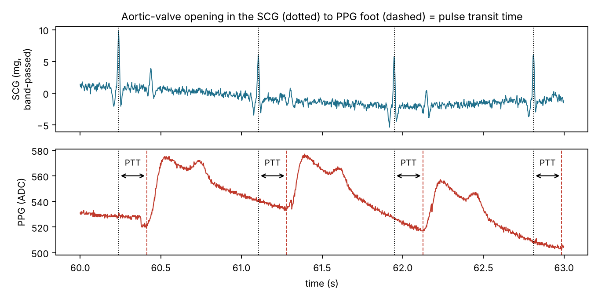
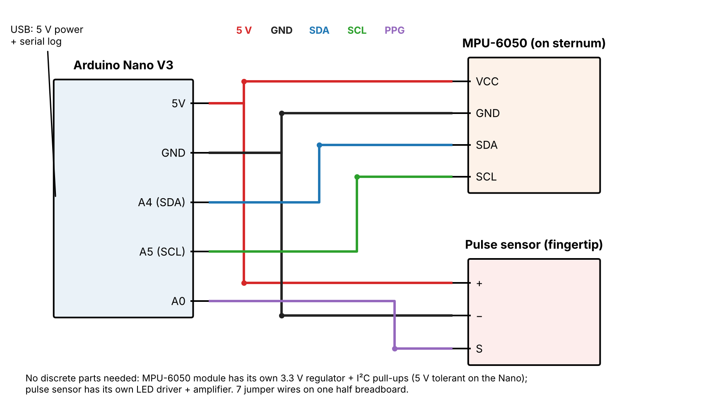
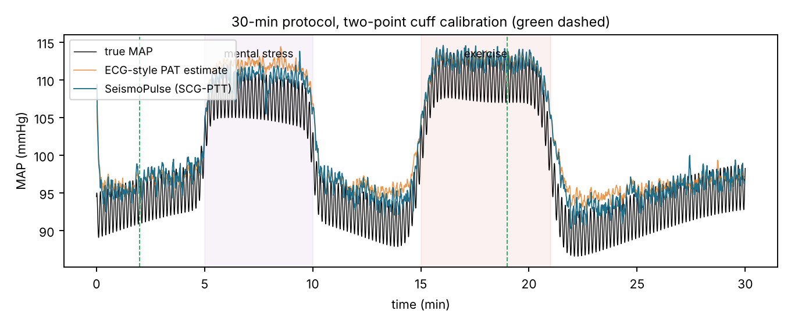
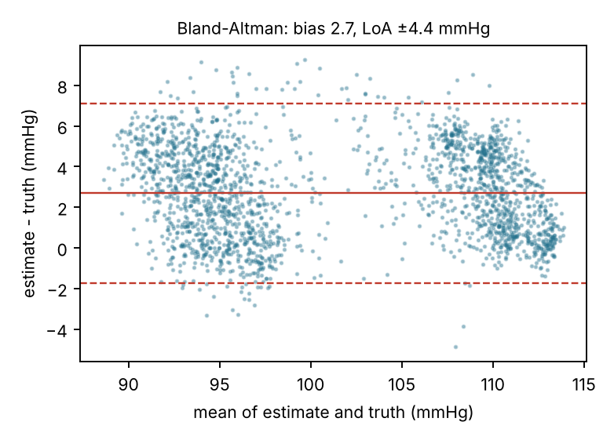

# SeismoPulse

**A ₹410 cuffless blood-pressure trend monitor that times the pulse from the heart's own valve opening.**

SeismoPulse measures **pulse transit time (PTT)**: the delay between the **aortic valve opening**, felt as a tiny chest vibration by an MPU-6050 accelerometer on the sternum (a *seismocardiogram*, SCG), and the **arrival of the pulse at the fingertip**, seen by a PPG pulse sensor. Arteries stiffen as pressure rises, so the pulse travels faster and PTT gets shorter. After a quick cuff calibration, an Arduino Nano turns every beat into a **mean-arterial-pressure trend**, plus heart rate and HRV (RMSSD), entirely on-device.

> 23MAT204 Lab Exam (Amrita Vishwa Vidyapeetham, School of AI): affordable healthcare edge-AI device using only the approved kit.
> Author: **C Saihardhik Reddy** (CB.AI.U4AID25112), Section B, Group B8.
> Educational prototype. **Not a medical device**: it reports trends, not diagnoses.



---

## 1. Problem

High blood pressure is a leading, largely silent cardiovascular risk factor, and a large share of people who have it don't know it. Cuff measurements are **intermittent** (one reading a day at best), **uncomfortable at night**, and miss the moment-to-moment surges that matter: stress responses, exertion, post-medication changes, overnight non-dipping.

Most cheap "cuffless" devices time the pulse from the **ECG R-peak** (pulse *arrival* time, PAT). PAT includes the **pre-ejection period (PEP)**, the delay between electrical activation and the valve actually opening. PEP changes with stress and contractility independently of BP, so it corrupts the estimate.

## 2. Concept: what it does and whom it benefits

- An MPU-6050 is taped to the sternum and sampled at 500 Hz. The Nano extracts the **aortic-opening (AO) peak** of every heartbeat from the band-passed (5–40 Hz) chest acceleration.
- The pulse sensor on the fingertip gives the **PPG foot**, detected with the *intersecting-tangent* method used in arterial-stiffness research.
- **PTT = PPG foot − AO.** This is the true vascular transit time, with PEP excluded by design.
- **Calibration:** `MAP = a + b·ln(PTT)`, which follows from the Moens–Korteweg equation with exponential wall elasticity. Send `C120/80` over serial with a cuff reading. One reading fixes the offset (using a population slope); a second reading at a different BP level fits the personal slope.
- **Output:** per-beat HR, PTT, MAP/SYS/DIA estimate, signal-quality %, and RMSSD every 30 beats, as serial CSV ready for the Arduino Serial Plotter.

**Beneficiaries:** home BP-trend tracking between clinic visits; stress and exercise BP-response screening; affordable research and teaching rigs for cardiovascular physiology; low-resource clinics where a ₹410 trend monitor complements a shared cuff.

## 3. Innovation statement

1. **Mechanical timing, not electrical.** Most cheap cuffless-BP prototypes start the clock at the ECG R-peak, which includes PEP. SeismoPulse starts it at the **mechanical** event the pulse wave actually comes from: the aortic valve opening. It uses a ₹95 IMU and needs **no electrodes, no ECG front-end and no skin current**.
2. **An IMU used as a cardiac sensor.** The MPU-6050 is usually used for motion and falls. Here it works as a 0.06 mg-resolution seismocardiograph.
3. **Physics-based calibration** (log-PTT from Moens–Korteweg and exponential elasticity) instead of a black-box model. It needs just two cuff readings and runs as two floats on an 8-bit MCU.
4. **Fully on-edge:** integer IIR filters, a 600-byte SCG ring buffer, look-back AO search triggered by each PPG foot, and a signal-quality gate, all within the Nano's 2 KB of RAM.

## 4. Hardware (approved kit only)

| # | Kit item | Qty | Role |
|---|---|---|---|
| 2 | Arduino Nano V3 (CH340) | 1 | 500 Hz dual-channel acquisition, filtering, beat detection, calibration, serial output |
| 4 | MPU-6050 6-DOF IMU | 1 | Seismocardiogram (chest-wall acceleration, Z axis) |
| 3 | Pulse sensor (PPG) | 1 | Fingertip pulse arrival |
| 10 | Half breadboard | 1 | Solder-free assembly |
| 11 | Jumper wires | 7 | Connections |

**Not used:** ESP32, HC-SR04, servo, piezo, thermistor, LDRs, resistors, probes, 9 V snap. Power and logging come over USB.

## 5. Cost

| Item | Price |
|---|---:|
| Arduino Nano V3 | ₹155 |
| MPU-6050 | ₹95 |
| Pulse sensor | ₹75 |
| Half breadboard | ₹50 |
| Jumper wires (bundle) | ₹35 |
| **Total** | **₹410** |

Assumptions: whole bundles are charged at full listed price (only 7 of 30 jumpers are used; pro-rated, the total is about ₹333). The USB cable and power bank are existing accessories. A typical automatic upper-arm cuff costs several times more and gives only spot readings.

## 6. Working principle and algorithm



| Nano | → | Module |
|---|---|---|
| 5V | → | MPU VCC, Pulse + |
| GND | → | MPU GND, Pulse − |
| A4 | → | MPU SDA |
| A5 | → | MPU SCL |
| A0 | → | Pulse S |

```
every 2 ms (500 Hz)
  az  = MPU-6050 accel Z (±2 g, DLPF 94 Hz)  -> HP 5 Hz -> LP 40 Hz -> SCG ring buffer (300 samples)
  ppg = analogRead(A0)                       -> LP ~10 Hz -> slope
PPG beat: slope > adaptive threshold (40 % of recent max)  ... until slope <= 0
  amplitude gate (rejects noise); foot = intersecting tangent (max-slope line ∩ preceding minimum)
  AO   = argmax SCG in [foot − 350 ms, foot − 60 ms]
  PTT  = foot − AO
  SQI  : RR 330–1500 ms, PTT 60–350 ms, |PTT − EMA| < 25 %
  EMA  : PTT (α 0.15), HR (α 0.2); RMSSD over 30 beats
  MAP  = a + b·ln(PTT);  SYS = MAP + 2PP/3,  DIA = MAP − PP/3  (PP from the cuff calibration)
  thresholds auto-reset after 2 s without a beat (artefact recovery)
```

The filter delays (SCG band-pass, PPG low-pass) are constant, so they shift PTT by a fixed amount that the calibration offset absorbs.

## 7. Evidence: physiological simulation

`sim/seismopulse_sim.py` builds a **30-minute, 500 Hz physiological recording**:

- **Protocol:** rest, mental stress (min 5–10), recovery, exercise (min 15–21), recovery, plus Mayer waves and slow drift. MAP ranges from 87 to 114 mmHg.
- **Heart:** heart rate with respiratory sinus arrhythmia; **PEP that varies from 74 to 115 ms with sympathetic tone**.
- **Arteries:** PTT from the Moens–Korteweg / exponential-elasticity model.
- **Sensors:** MPU-6050 SCG with 16-bit quantisation, a 10-bit PPG, respiration, noise and 12 motion-artefact bursts.

It then runs a **port of the firmware pipeline**. A conventional **ECG-style PAT** (R-peak to PPG foot) is evaluated on the same data for comparison.



| Metric (30 min, 2287 beats) | SeismoPulse (SCG→PPG PTT) | ECG-style PAT |
|---|---:|---:|
| Beats detected / true | 2318 / 2287 | same PPG |
| SQI pass rate | 97.9 % | n/a |
| PTT jitter (SD, after constant offset) | 3.9 ms | n/a |
| MAP MAE, **two-point** calibration | **2.88 mmHg** | 3.44 mmHg |
| MAP error SD, two-point | **2.26 mmHg** | 2.38 mmHg |
| MAP MAE, one-point (population slope) | 4.23 mmHg | 3.60 mmHg |
| Correlation with true MAP | 0.961 | 0.956 |



**Honest reading.** The data are synthetic, generated from published physiological models, so these numbers show that the **pipeline works and that excluding PEP helps once the slope is personalised**. They are *not* clinical accuracy. With one-point calibration, the population slope (−55) is far from this simulated subject's true slope, which dominates the error. That is why the firmware supports and recommends two-point calibration. Validation against a cuff on real subjects is the next step (see the roadmap).

### Run it

```bash
pip install numpy scipy matplotlib
python sim/seismopulse_sim.py        # writes docs/fig_*.png and docs/results.json
```

Firmware: open `firmware/SeismoPulse/SeismoPulse.ino` in the Arduino IDE (board **Arduino Nano**, processor **ATmega328P (Old Bootloader)** for most CH340 clones), upload, then open the Serial Monitor or Serial Plotter at 115200 baud.

### Bench demo

1. Tape the MPU-6050 flat on the lower sternum (Z axis into the chest) and clip the pulse sensor on the index finger. Sit still and breathe normally.
2. Watch `PTT_ms` stabilise (SQI > 80 %). Take a cuff reading and type `C<sys>/<dia>`.
3. Do 2 minutes of mental arithmetic or 30 squats, take a second cuff reading, and type `C<sys>/<dia>` again (two-point calibration).
4. Repeat the stress task and compare the SeismoPulse MAP trend with fresh cuff readings.

## 8. Impact, limitations and safety

**Impact:** continuous, beat-to-beat BP *trends* for ₹410, roughly 1/5 to 1/10 the price of a home cuff, with no inflation, so it can run overnight or during activity. It is also a teaching and research platform for cardiovascular timing physiology.

**Limitations**

- Synthetic validation only. Real SCG morphology varies with body habitus, posture and sensor placement, and AO detection may need template matching.
- Calibration drifts over hours to days and with posture or vasomotor tone, so periodic re-calibration with a cuff is required.
- Speech, walking and coughing corrupt the SCG; the SQI gate drops those beats rather than fixing them.
- The PTT–BP relationship is weaker for diastolic pressure and in stiff (elderly) arteries.
- 500 Hz sampling gives 2 ms timing resolution, so a 1 mmHg change is near the per-beat noise floor (smoothed by the EMA).

**Safety:** no electrodes and no current through the body. The system runs on 5 V USB only; use a power bank or a battery-powered laptop, not a mains-charging laptop, while it is worn. The pulse sensor and MPU-6050 are 5 V-compatible on the Nano (the ESP32's 3.3 V limit does not apply). **Not for diagnosis or treatment decisions.**

## Roadmap

- [ ] Real-subject dataset with cuff reference (consented, non-clinical)
- [ ] SCG template-matching AO detector + learned SQI (tiny logistic regression on the MCU)
- [ ] ESP32 BLE streaming to a phone app with a nightly dipping report
- [ ] Posture compensation from the same IMU's gravity vector

## Repository layout

```
firmware/SeismoPulse/SeismoPulse.ino   Arduino Nano firmware
sim/seismopulse_sim.py                 physiology + sensor simulator, firmware port, evaluation
hardware/circuit.png, circuit.py       wiring diagram
docs/                                  figures, results.json, report PDF
```

## References (background)

- Mukkamala R. et al., "Toward ubiquitous blood pressure monitoring via pulse transit time: theory and practice," *IEEE Trans. Biomed. Eng.*, 2015.
- Inan O. T. et al., "Ballistocardiography and seismocardiography: a review of recent advances," *IEEE J. Biomed. Health Inform.*, 2015.
- Payne R. A. et al., "Pulse transit time measured from the ECG: an unreliable marker of beat-to-beat blood pressure," *J. Appl. Physiol.*, 2006.

## License

MIT
